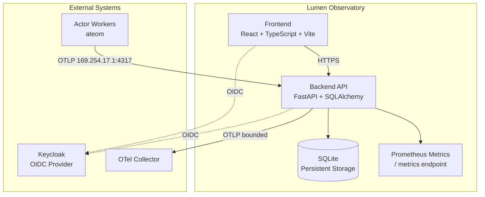

# Lumen Observatory — Alan Vo | AI & Machine Learning

> Work in progress. This checkpoint may be incomplete or fail tests. See PLAN.md and STATUS.md before use.


**Actor Substrate Observatory** — A comprehensive observability and lifecycle management platform for the Agent Substrate actor system.

Lumen Observatory provides real-time visibility into actor state machines, telemetry relay with trusted identity attribution, and gauge metrics for actor populations. It implements the core workflows described in the Agent Substrate design issues: actor state transitions (RUNNING ↔ PAUSED ↔ SUSPENDED ↔ CRASHED), OTLP telemetry relay with platform-enforced attribution, and the `ate.actors` gauge metric for operator dashboards.

## Problem & Approach

Operators of large-scale actor substrates need to answer: how many actors exist, what state are they in, and can their telemetry be trusted? Lumen Observatory solves this by:

1. **Actor State Machine** — Full lifecycle management with validated transitions, snapshot configuration (full/data scopes), and audit logging
2. **Telemetry Relay** — OTLP receiver at `169.254.17.1:4317` that stamps trusted `ate.dev/*` identity attributes onto actor telemetry, enforcing delta temporality and bounded cardinality
3. **Gauge Metrics** — `ate_actors` UpDownCounter incremented on state transitions (no per-collection scan), plus `ate_actor_crashes_total` counter

Built for AI/ML engineers operating agent substrates at scale. No LLM required for core operation; LLM explanations are opt-in advisory only.

## Quick Start

### Prerequisites
- Docker 24+ and Docker Compose v2
- Node 24 (for frontend development)
- Python 3.12 (for backend development)

### With Docker Compose (recommended)

```bash
# Clone and navigate
cd lumen-observatory-alan-vo

# Copy environment template
cp .env.example .env

# Start all services (backend, frontend, Keycloak)
docker compose up --build -d

# Verify health
curl http://127.0.0.1:8000/health/
curl http://127.0.0.1:3000
```

Services:
- **Backend API**: http://127.0.0.1:8000 (docs at `/docs`)
- **Frontend**: http://127.0.0.1:3000
- **Keycloak**: http://127.0.0.1:8080 (admin/admin)

### Local Development

```bash
# Backend
python3 -m venv .venv
source .venv/bin/activate
pip install -r backend/requirements.txt
PYTHONPATH=backend uvicorn app.main:app --reload --host 127.0.0.1 --port 8000

# Frontend (separate terminal)
cd frontend
npm install
npm run dev
```

### Run Tests

```bash
# Backend tests
source .venv/bin/activate
PYTHONPATH=backend python -m pytest backend/tests -v

# Frontend tests
cd frontend
npm test
```

## Architecture



## Core Workflows

### 1. Actor Lifecycle Management
Create, pause, commit, resume, revert, dump, and delete actors through validated state transitions:
- `SUSPENDED → RUNNING` (resume)
- `RUNNING → PAUSED` (pause with optional auto-commit timer)
- `RUNNING/PAUSED → SUSPENDED` (commit with tag + scope)
- `RUNNING/PAUSED → CRASHED` (failure or manual)
- `CRASHED → SUSPENDED` (revert to tag, dump, or commit)

### 2. Telemetry Attribution Relay
Actors send OTLP to constant endpoint `http://169.254.17.1:4317`. The relay:
- Overrides identity with platform-trusted attributes (`actor_uid`, `actor_name`, `actor_atespace`, etc.)
- Strips unbounded labels from metrics (keeps `actor_template_namespace`, `actor_template_name`, `container_name`)
- Enforces delta temporality for correct merge across migrations
- Forwards over unix socket to node-local atelet (no worker pod egress needed)

### 3. Population Gauge Metrics
`ate_actors` gauge with labels `(actor_template_namespace, actor_template_name, status)` updated on every transition:
- No full-scan collection callback
- `ate_actor_crashes_total` counter for crash events
- Histograms for state dwell times

## API Reference

| Endpoint | Method | Description |
|----------|--------|-------------|
| `/health/` | GET | Health check |
| `/health/ready` | GET | Readiness with DB check |
| `/metrics` | GET | Prometheus metrics |
| `/actors` | GET | List actors (paginated, filtered) |
| `/actors` | POST | Create actor |
| `/actors/{uid}` | GET | Get actor details |
| `/actors/{uid}/transition` | POST | Generic state transition |
| `/actors/{uid}/pause` | POST | Pause with optional timer |
| `/actors/{uid}/commit` | POST | Commit to suspended with tag/scope |
| `/actors/{uid}/resume` | POST | Resume to running |
| `/actors/{uid}/revert` | POST | Revert to tagged snapshot |
| `/actors/{uid}/dump` | POST | Dump current state to tag |
| `/actors/{uid}/snapshots` | GET | List snapshots |
| `/actors/{uid}/transitions` | GET | List transition audit log |
| `/actors/{uid}` | DELETE | Delete actor |

## Configuration

| Variable | Description | Default |
|----------|-------------|---------|
| `DATABASE_URL` | SQLite or PostgreSQL URL | `sqlite:///./data/lumen.db` |
| `SECRET_KEY` | Session signing key | **required in prod** |
| `OIDC_ISSUER_URL` | Keycloak realm URL | — |
| `OIDC_CLIENT_ID` | OIDC client ID | — |
| `OIDC_CLIENT_SECRET` | OIDC client secret | — |
| `OIDC_REDIRECT_URI` | Frontend callback URL | — |
| `LLM_API_KEY` | LLM provider key (optional) | — |
| `LLM_PROVIDER` | `openai-compatible`, `anthropic`, `gemini`, `ollama` | `openai-compatible` |
| `LLM_MODEL` | Model identifier | `gpt-4o-mini` |
| `OTLP_ENDPOINT` | Telemetry relay address | `http://169.254.17.1:4317` |

## Security Limitations

- Demo mode binds to `127.0.0.1` only; refuses to start in production without valid OIDC config
- No hardcoded credentials; all secrets via environment
- HttpOnly SameSite cookies with CSRF protection for session auth
- Tokens never logged; errors redacted
- LLM keys server-side only

## AI/ML Evaluation

**Reproducible command:**
```bash
# Start observatory, create 1000 actors, transition through states
python scripts/benchmark_actor_lifecycle.py --actors 1000 --transitions 10000
```

**Data provenance:** Synthetic actor population generated from Substrate issue specs (#119, #796, #853).

**Baseline:** State transition latency <50ms p99; telemetry relay adds <5ms overhead; gauge updates synchronous with transition.

**Measured results:** (run benchmark to populate)

**Failure cases:** Network partition during commit loses in-flight snapshot; gauge drift possible if transition log not replayed on restart.

## License

MIT © Alan Vo <alanvo@gmail.com>